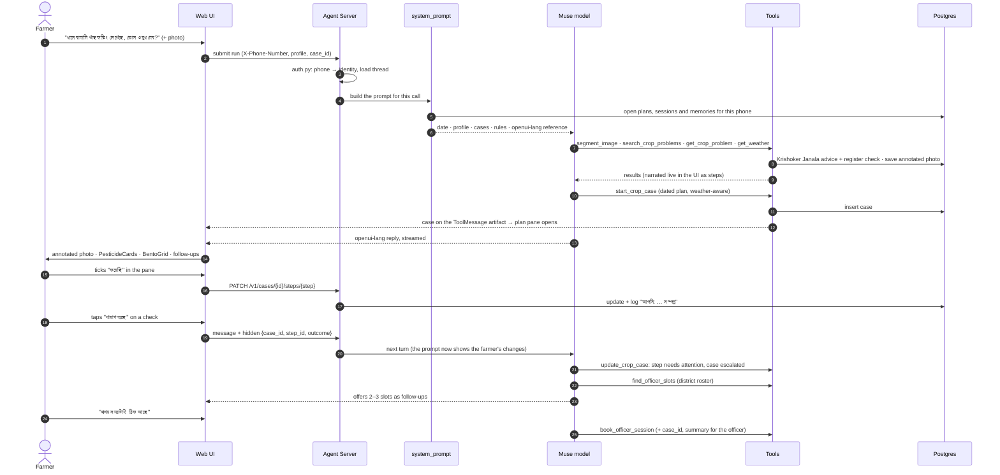

# KrishiBondhu.AI: architecture and development

How the pieces fit together, and how to run them for development. For what the project is, see the
[README](README.md).

## Run locally (development)

Needs a Postgres database: set `DB_URI` in `.env` (e.g. Aiven, `...?sslmode=require`). Once, and after
schema changes:

```bash
uv run krishi-db migrate      # app tables, row-level security, officer roster (idempotent)
uv run krishi-db load-agri    # pesticide register + Krishoker Janala advice from assets/agri.db
```

Postgres holds everything that persists: farmers, crop cases, photos and officer bookings (one row-level
security policy per table, so a farmer's queries only ever see their own rows), conversation checkpoints
and long-term memory (`persistence.py`), and the reference data (`agri` schema). The Agent Server's thread
list itself still lives in `.langgraph_api/` (local dev server).

Two processes:

```bash
# 1. Agent backend — LangGraph Agent Server on :2024 (also serves the FastAPI routes)
uv sync
uv run meta-hackathon

# 2. Web UI — Next.js + OpenUI on :3000
cd frontend && npm install && npm run dev
```

Open http://localhost:3000 and enter a mobile number (e.g. `01712345678`). There is no auth yet: the
`X-Phone-Number` header is the user identity, and each number only sees its own conversations.

### With Docker

`docker compose up --build` runs the backend, the frontend and a Caddy proxy on http://localhost:3000
(`/api/*` goes to the Agent Server), plus an ngrok tunnel for a public HTTPS URL; set `NGROK_AUTHTOKEN` in
`.env`. The backend container runs `krishi-db migrate` on start.

### Settings (`.env`)

| Variable | What |
| --- | --- |
| `META_API_KEY`, `META_BASE_URL`, `MODEL_NAME` | Muse model endpoint |
| `SEGMENT_MODEL_NAME`, `TRANSCRIBE_MODEL_NAME` | SAM 3.1 and Meta ASR (defaults set) |
| `DB_URI` | Postgres connection string |
| `PUBLIC_BASE_URL` | where annotated photos are served from |
| `LANGSMITH_*` | tracing |

## Architecture

### The full flow: farmer → agent → tools → UI

```mermaid
flowchart TB
    farmer(["👩‍🌾 Farmer<br/>text · up to 2 photos · taps on cards, forms, the plan"])

    subgraph WEB["Web UI · Next.js :3000 (frontend/)"]
        direction TB
        gate["ProfileGate<br/>phone · name · division / district / area"]
        composer["Composer<br/>text + photos (downscaled to 1280 px JPEG data URLs)"]
        stream["useStream (@langchain/react)<br/>header X-Phone-Number<br/>configurable: profile + case_id of the open plan"]
        turns["buildTurns<br/>user message · tool steps · final reply"]
        activity["ToolActivity<br/>Bangla narration per tool, folded into '৪টি ধাপ সম্পন্ন'"]
        progressive["progressive.ts<br/>re-render only on complete statements"]
        renderer["OpenUI Renderer + library.ts<br/>stock cards, tables, forms, follow-ups, sources"]
        custom["Custom components<br/>Map (Leaflet + OSM) · BentoGrid (Commons photos)<br/>PesticideCards (dose + WHO hazard) · theme-aware charts"]
        zoom["ImageZoom<br/>any reply photo full size + credit"]
        pane["CasePane<br/>plan timeline (treatment or cultivation): progress ring, track,<br/>phases, steps with sources, warning signs, photos, activity log"]
        sidebar["Sidebar (collapsible; a drawer on phones)<br/>plans · officer sessions · photo folder · conversations"]
    end

    subgraph SERVER["LangGraph Agent Server :2024 (langgraph.json)"]
        direction TB
        auth["auth.py<br/>X-Phone-Number → identity (E.164)<br/>threads owned by that phone"]
        threads[("Threads<br/>checkpoints in Postgres (AsyncPostgresSaver)")]

        subgraph AGENT["krishi_advisor graph · create_agent (agent/)"]
            direction TB
            prompt["system_prompt middleware<br/>date block · farmer profile · open plans · upcoming officer sessions<br/>long-term memories · (+ full plan of the one open in the pane)<br/>persona & rules · openui-lang reference"]
            model{{"Muse model (META_BASE_URL)<br/>reads text + photos, plans tool calls,<br/>writes the reply in openui-lang"}}
            guard["content_filter_guard<br/>retry once, then Bangla fallback"]
            limit["ToolCallLimit<br/>search_images ≤ 2 per run"]
            toolnode["Tool node"]
        end

        subgraph API["FastAPI routes (main.py, mounted on the server)"]
            direction TB
            casesApi["/v1/cases<br/>list · tick / move / skip a step · close · delete"]
            imagesApi["/v1/images<br/>farmer's annotated photos"]
            bookingsApi["/v1/bookings<br/>list · cancel"]
            pestApi["/v1/pesticides<br/>register lookups"]
            media["/media/{id}.jpg<br/>annotated photos"]
            chatApi["/v1/chat · /v1/chat/stream · /v1/chat/history<br/>plain-text channels (WhatsApp later)"]
        end
    end

    subgraph TOOLS["Tools (src/meta_hackathon/tools/)"]
        direction TB
        kb["search_crop_problems · get_crop_problem<br/>Krishoker Janala advice (DAE), every chemical<br/>checked against the pesticide register"]
        web["search_internet<br/>live web search + cited sources"]
        weather["get_weather<br/>now · next 24 h · daily"]
        geo["geocode_location<br/>places in Bangladesh"]
        seg["segment_image<br/>marks pests / lesions on the farmer's photo"]
        imgs["search_images<br/>reference photos with author & licence"]
        findP["find_registered_pesticides<br/>crop + pest → ingredients, brands, reg no, dose"]
        lookP["lookup_pesticide_product<br/>brand / reg no → registered uses"]
        caseTools["start_crop_case · start_cultivation_plan<br/>update / get_crop_case<br/>dated steps (or days from day 0), phases, outcomes, photos"]
        booking["find_officer_slots · book_officer_session<br/>change_officer_booking<br/>district officer roster, Sun–Thu slots"]
        memory["create_or_update_user_memory<br/>fetch_user_memory"]
    end

    subgraph EXT["External services"]
        direction TB
        muse["Meta Muse API<br/>chat model + web_search"]
        sam["SAM 3.1 (Meta Responses API)"]
        meteo["Open-Meteo<br/>geocoding + forecast"]
        osm["OpenStreetMap Nominatim"]
        commons["Wikimedia Commons API"]
        smith["LangSmith tracing"]
    end

    subgraph STORE["Data"]
        direction TB
        pestDb[("Postgres · agri schema<br/>DAE pesticide register (Dec 2020)<br/>Krishoker Janala: 998 problems on 122 crops")]
        hazards["hazards.py<br/>WHO hazard class per ingredient"]
        appDb[("Postgres · app tables, row-level security per farmer<br/>farmers · crop_cases · images · officers · bookings")]
        memDb[("Postgres store<br/>long-term memories per farmer")]
        mediaDir[(".media/<br/>annotated JPEGs")]
    end

    %% Farmer → UI → server
    farmer --> gate --> composer --> stream
    stream -- "POST run · SSE stream" --> auth --> threads --> prompt
    appDb -. "open plans + sessions every turn" .-> prompt
    memDb -. "memories every turn" .-> prompt

    %% Agent loop
    prompt --> model
    model -- "tool calls" --> limit --> toolnode
    toolnode -- "tool results" --> model
    model -- "blocked / empty" --> guard --> model
    model -. traces .-> smith
    model <--> muse

    %% Tools → services and data
    toolnode --> kb & web & weather & geo & seg & imgs & findP & lookP & caseTools & booking & memory
    kb --> pestDb
    booking --> appDb
    memory --> memDb
    web --> muse
    weather --> meteo
    geo --> osm
    seg --> sam
    seg --> mediaDir
    seg -- "who / which thread / labels" --> appDb
    imgs --> commons
    findP --> pestDb
    lookP --> pestDb
    findP --> hazards
    lookP --> hazards
    caseTools --> appDb

    %% Back to the UI
    model -- "openui-lang reply (streamed)" --> threads
    threads -- "messages + tool results" --> stream --> turns
    turns --> activity
    turns --> progressive --> renderer --> custom
    renderer --> zoom
    turns -- "case on the ToolMessage artifact" --> pane

    %% UI actions back into the loop
    renderer -- "follow-ups · forms · buttons" --> composer
    pane -- "better / same / worse · send photo · ask<br/>(+ hidden case_id / step_id)" --> composer
    pane -- "tick off · move date · skip · close" --> casesApi --> appDb
    sidebar --> imagesApi --> appDb
    sidebar -- "threads.search" --> threads
    sidebar --> casesApi
    sidebar --> bookingsApi --> appDb
    custom -. "photos" .-> media --> mediaDir
    custom -. "Commons thumbnails" .-> commons
    pestApi --> pestDb
    chatApi --> AGENT
    renderer --> farmer
    pane --> farmer
```



### One turn, step by step



## How it fits together

- **Agent** (`src/meta_hackathon/agent/`): LangChain `create_agent` on Muse, with tools in
  `src/meta_hackathon/tools/`:
  - `search_crop_problems` / `get_crop_problem`: Krishoker Janala, the DAE's advice for 998 problems on
    122 crops, ranked with Bangla spelling normalisation; every chemical it names is checked against the
    pesticide register for that crop (`knowledge.py`).
  - `find_registered_pesticides` / `lookup_pesticide_product`: the DAE pesticide register (Dec 2020),
    shown as cards with the WHO hazard class (`pesticides.py`, `hazards.py`).
  - `segment_image` (SAM 3.1), `get_weather` (Open-Meteo), `geocode_location` (OpenStreetMap Nominatim),
    `search_internet` (Muse web search), `search_images` (Wikimedia Commons).
  - `start_crop_case` / `start_cultivation_plan` / `update_crop_case` / `get_crop_case`: plans (below).
  - `find_officer_slots` / `book_officer_session` / `change_officer_booking`: sessions with the district's
    agriculture officer (`bookings.py`, roster in `assets/officers.csv`).
  - `create_or_update_user_memory` / `fetch_user_memory`: lasting facts about the farmer (land, crops,
    soil, what worked), in the LangGraph Postgres store under `("memories", phone)`.
- **Plans** (`src/meta_hackathon/cases.py`): two kinds on one timeline of dated steps (actions, and checks
  where the farmer reports better / same / worse):
  - *treatment*: a diagnosed problem, from today to the last check;
  - *cultivation*: growing something (a rice season, mushrooms, a fertiliser schedule), with steps counted
    in days from a day 0 (transplanting, sowing, spawning) so moving that date moves every step, grouped
    into phases, with a cited source for every dose.

  The agent sees the farmer's open plans in its prompt every turn; the web UI shows a plan beside the chat
  and changes it through `/v1/cases`. Every change, by either side, goes into the plan's activity log.
- **Storage** (`db.py`, `sql/schema.sql`, `persistence.py`): one Postgres database. App tables have a
  row-level-security policy per farmer: pooled connections run as the `krishi_app` role and set
  `app.phone` per transaction, so a farmer's queries only ever see their own rows. Conversation
  checkpoints and memories use LangGraph's `AsyncPostgresSaver` / `AsyncPostgresStore`; the reference data
  lives in the `agri` schema. The Agent Server's thread list itself is still in `.langgraph_api/`.
- **Agent Server** (`langgraph.json`): serves the graph to the web UI and runs `src/meta_hackathon/auth.py`,
  which turns `X-Phone-Number` into the user identity and scopes threads and memories to it.
- **Web UI** (`frontend/`): `useStream` from `@langchain/react` + OpenUI's `Renderer`, following the
  [LangChain OpenUI guide](https://docs.langchain.com/oss/python/langchain/frontend/integrations/openui).
  The agent replies in openui-lang (cards, sources, images, forms, charts, follow-ups), each tool call is
  narrated as a Bangla step in the chat, and a plan opens in a resizable pane on the right where the
  farmer can tick steps off, move them, report how the crop looks or send a photo. Voice input goes over a
  WebSocket to Meta ASR. The landing page is at `/`, the chat at `/chat`.
- **Plain-text API** (`src/meta_hackathon/api/`): `/v1/chat`, `/v1/chat/stream`, `/v1/chat/history` for
  text channels (WhatsApp later), mounted on the Agent Server, e.g. `http://localhost:2024/v1/chat`.

### Changing the UI components

The agent's openui-lang system prompt is generated from the component library in
`frontend/src/lib/library.ts` into `src/meta_hackathon/prompts/openui_prompt.md`. After editing the
library, run `npm run generate:prompt` in `frontend/` (it also runs on `npm run dev`) and commit the
regenerated prompt.
