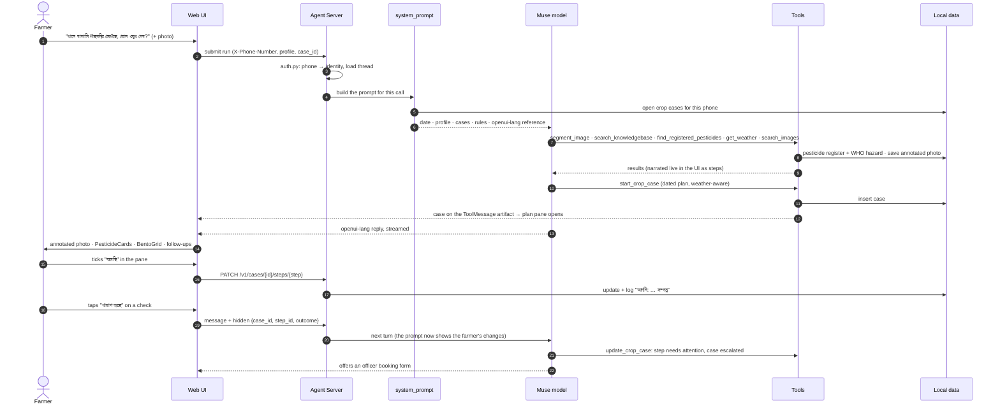

# Krishi Advisor

Bangla crop-health advisor for WhatsApp/Messenger/Web: photo/voice/text in, grounded Bangla advice out, with tracked cases, follow-ups and officer booking.

## Run locally

Two processes:

```bash
# 1. Agent backend — LangGraph Agent Server on :2024 (also serves the FastAPI routes)
uv sync
uv run meta-hackathon

# 2. Web UI — Next.js + OpenUI on :3000
cd frontend && npm install && npm run dev
```

Open http://localhost:3000 and enter a mobile number (e.g. `01712345678`). There is no auth yet: the
`X-Phone-Number` header is the user identity, and each number only sees its own conversations.

## Architecture

### The full flow: farmer → agent → tools → UI

```mermaid
flowchart TB
    farmer(["👩‍🌾 Farmer<br/>text · up to 2 photos · taps on cards, forms, the plan"])

    subgraph WEB["Web UI · Next.js :3000 (frontend/)"]
        direction TB
        gate["ProfileGate<br/>phone · name · division / district / area"]
        composer["Composer<br/>text + photos (downscaled to 1280 px JPEG data URLs)"]
        stream["useStream (@langchain/react)<br/>header X-Phone-Number<br/>configurable: profile + case_id of the open plan"]
        turns["buildTurns<br/>user message · tool steps · final reply"]
        activity["ToolActivity<br/>Bangla narration per tool, folded into '৪টি ধাপ সম্পন্ন'"]
        progressive["progressive.ts<br/>re-render only on complete statements"]
        renderer["OpenUI Renderer + library.ts<br/>stock cards, tables, forms, follow-ups, sources"]
        custom["Custom components<br/>Map (Leaflet + OSM) · BentoGrid (Commons photos)<br/>PesticideCards (dose + WHO hazard) · theme-aware charts"]
        zoom["ImageZoom<br/>any reply photo full size + credit"]
        pane["CasePane<br/>treatment-plan timeline: progress ring, track, steps,<br/>warning signs, photos, activity log"]
        sidebar["Sidebar<br/>plans · photo folder · conversations"]
    end

    subgraph SERVER["LangGraph Agent Server :2024 (langgraph.json)"]
        direction TB
        auth["auth.py<br/>X-Phone-Number → identity (E.164)<br/>threads owned by that phone"]
        threads[("Thread store<br/>checkpoints · messages")]

        subgraph AGENT["krishi_advisor graph · create_agent (agent/)"]
            direction TB
            prompt["system_prompt middleware<br/>date block · farmer profile · open crop cases<br/>(+ full plan of the case open in the pane)<br/>persona & rules · openui-lang reference"]
            model{{"Muse model (META_BASE_URL)<br/>reads text + photos, plans tool calls,<br/>writes the reply in openui-lang"}}
            guard["content_filter_guard<br/>retry once, then Bangla fallback"]
            limit["ToolCallLimit<br/>search_images ≤ 2 per run"]
            toolnode["Tool node"]
        end

        subgraph API["FastAPI routes (main.py, mounted on the server)"]
            direction TB
            casesApi["/v1/cases<br/>list · tick / move / skip a step · close · delete"]
            imagesApi["/v1/images<br/>farmer's annotated photos"]
            pestApi["/v1/pesticides<br/>register lookups"]
            media["/media/{id}.jpg<br/>annotated photos"]
            chatApi["/v1/chat · /v1/chat/stream · /v1/chat/history<br/>plain-text channels (WhatsApp later)"]
        end
    end

    subgraph TOOLS["Tools (src/meta_hackathon/tools/)"]
        direction TB
        kb["search_knowledgebase<br/>DAE / BRRI guidance (simulated)"]
        web["search_internet<br/>live web search + cited sources"]
        weather["get_weather<br/>now · next 24 h · daily"]
        geo["geocode_location<br/>places in Bangladesh"]
        seg["segment_image<br/>marks pests / lesions on the farmer's photo"]
        imgs["search_images<br/>reference photos with author & licence"]
        findP["find_registered_pesticides<br/>crop + pest → ingredients, brands, reg no, dose"]
        lookP["lookup_pesticide_product<br/>brand / reg no → registered uses"]
        caseTools["start / update / get_crop_case<br/>plan as dated steps, outcomes, photos, stage"]
        booking["schedule_officer_session<br/>SAAO booking (simulated)"]
    end

    subgraph EXT["External services"]
        direction TB
        muse["Meta Muse API<br/>chat model + web_search"]
        sam["SAM 3.1 (Meta Responses API)"]
        meteo["Open-Meteo<br/>geocoding + forecast"]
        osm["OpenStreetMap Nominatim"]
        commons["Wikimedia Commons API"]
        smith["LangSmith tracing"]
    end

    subgraph STORE["Local data"]
        direction TB
        pestDb[("assets/pesticides.db<br/>DAE register, Dec 2020<br/>7,231 product × crop × pest × dose rows")]
        hazards["hazards.py<br/>WHO hazard class per ingredient"]
        appDb[(".data/krishi.sqlite3<br/>crop_cases · images")]
        mediaDir[(".media/<br/>annotated JPEGs")]
    end

    %% Farmer → UI → server
    farmer --> gate --> composer --> stream
    stream -- "POST run · SSE stream" --> auth --> threads --> prompt
    appDb -. "open cases every turn" .-> prompt

    %% Agent loop
    prompt --> model
    model -- "tool calls" --> limit --> toolnode
    toolnode -- "tool results" --> model
    model -- "blocked / empty" --> guard --> model
    model -. traces .-> smith
    model <--> muse

    %% Tools → services and data
    toolnode --> kb & web & weather & geo & seg & imgs & findP & lookP & caseTools & booking
    web --> muse
    weather --> meteo
    geo --> osm
    seg --> sam
    seg --> mediaDir
    seg -- "who / which thread / labels" --> appDb
    imgs --> commons
    findP --> pestDb
    lookP --> pestDb
    findP --> hazards
    lookP --> hazards
    caseTools --> appDb

    %% Back to the UI
    model -- "openui-lang reply (streamed)" --> threads
    threads -- "messages + tool results" --> stream --> turns
    turns --> activity
    turns --> progressive --> renderer --> custom
    renderer --> zoom
    turns -- "case on the ToolMessage artifact" --> pane

    %% UI actions back into the loop
    renderer -- "follow-ups · forms · buttons" --> composer
    pane -- "better / same / worse · send photo · ask<br/>(+ hidden case_id / step_id)" --> composer
    pane -- "tick off · move date · skip · close" --> casesApi --> appDb
    sidebar --> imagesApi --> appDb
    sidebar -- "threads.search" --> threads
    sidebar --> casesApi
    custom -. "photos" .-> media --> mediaDir
    custom -. "Commons thumbnails" .-> commons
    pestApi --> pestDb
    chatApi --> AGENT
    renderer --> farmer
    pane --> farmer
```



### One turn, step by step



## How it fits together

- **Agent** (`src/meta_hackathon/agent/`): LangChain `create_agent` on Muse, with tools in
  `src/meta_hackathon/tools/` (`get_weather` uses Open-Meteo, `geocode_location` OpenStreetMap Nominatim, `search_internet` Muse's built-in web search, `segment_image` SAM 3.1, `find_registered_pesticides` / `lookup_pesticide_product` over the DAE pesticide register, `search_images` Wikimedia Commons reference photos (shown in a bento grid, tap to zoom), and `start/update/get_crop_case` for treatment plans; the knowledge base and booking are simulated for now). LangSmith tracing comes from `.env`.
- **Pesticide register** (`src/meta_hackathon/pesticides.py`): the DAE list of
  registered pesticides (up to Dec 2020) as SQLite in `assets/pesticides.db`; the agent only recommends
  what is registered for the crop and pest, with the listed dose, shown as cards with the WHO hazard class
  (`hazards.py`). The DB was built from the DAE PDF by the separate pesticide-rag project; `GET /v1/pesticides` exposes the lookups.
- **Crop cases** (`src/meta_hackathon/cases.py`): a diagnosed problem with its treatment plan as dated
  steps (actions, and checks where the farmer reports better / same / worse), stored in SQLite under
  `.data/`. The agent starts and updates cases with tools and sees the farmer's open cases in its prompt
  every turn; the web UI shows the plan as a timeline beside the chat and changes it through `/v1/cases`.
- **Agent Server** (`langgraph.json`): serves the graph to the web UI, stores threads, and runs
  `src/meta_hackathon/auth.py`, which turns `X-Phone-Number` into the user identity and scopes threads to it.
- **Web UI** (`frontend/`): `useStream` from `@langchain/react` + OpenUI's `Renderer`, following the
  [LangChain OpenUI guide](https://docs.langchain.com/oss/python/langchain/frontend/integrations/openui).
  The agent replies in openui-lang (cards, sources, images, forms, charts, follow-ups), each tool call is
  narrated as a step in the chat, and a treatment plan opens in a resizable pane on the right, where
  the farmer can tick steps off, move them, report how the plants look or send a photo.
- **Plain-text API** (`src/meta_hackathon/api/`): `/v1/chat`, `/v1/chat/stream`, `/v1/chat/history` for
  text channels (WhatsApp later), mounted on the Agent Server, e.g. `http://localhost:2024/v1/chat`.

### Changing the UI components

The agent's openui-lang system prompt is generated from the component library in
`frontend/src/lib/library.ts` into `src/meta_hackathon/prompts/openui_prompt.md`. After editing the
library, run `npm run generate:prompt` in `frontend/` (it also runs on `npm run dev`) and commit the
regenerated prompt.
