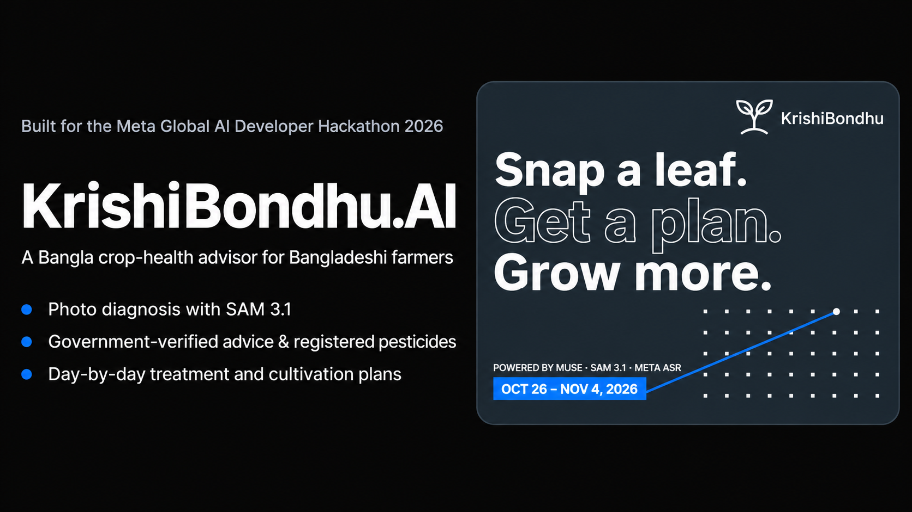
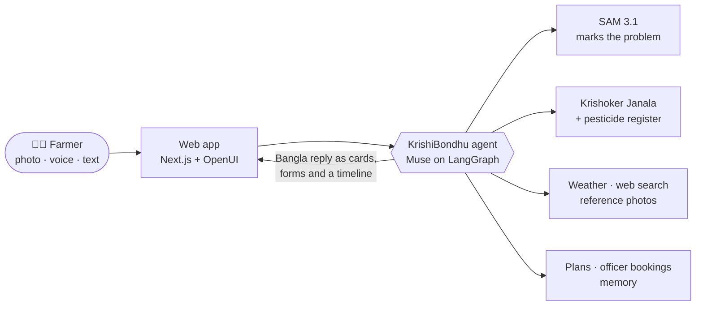

<h1 align="center">KrishiBondhu.AI 🌱</h1>

<p align="center">
  <b>কৃষকের ডিজিটাল বন্ধু</b>: the farmer's digital friend.<br/>
  Snap a photo of a sick leaf, get a Bangla treatment plan you can trust, and a follow-up until the crop recovers.
</p>

<p align="center">
  
  
  
  
  
  
</p>

---

## Why

A Bangladeshi farmer who spots brown patches on their rice usually asks the pesticide seller, who sells
whatever is on the shelf. The government's agriculture department publishes good advice and a register of
which pesticides are approved for which crop, but it sits on websites and in PDFs few farmers will ever
read, and the local agriculture officer looks after thousands of farmers.

**KrishiBondhu** puts that official knowledge in the farmer's pocket, in Bangla, by voice or photo, and
stays with them after the first answer.

## What it does

|  |  |
| --- | --- |
| 📸 **Sees the problem** | Send a photo; SAM 3.1 marks the lesions or pests on it, so the farmer sees exactly what the diagnosis is based on. Unsure? It says so and asks for a clearer photo. |
| 📚 **Answers from official sources** | Advice comes from *Krishoker Janala* (কৃষকের জানালা), the Department of Agricultural Extension's guidance on 998 problems across 122 crops, with reference photos to compare. |
| 🧪 **Only registered pesticides** | Every chemical is checked against the DAE pesticide register for *that* crop. Unregistered ones are flagged, never recommended. Doses per bigha, with the WHO hazard class. |
| 🗓️ **A plan, day by day** | Treatment becomes a timeline: spray on a dry day (it checks the forecast), look again on day 3, send a photo. Also for growing things: a full Boro rice season, mushrooms, a fertiliser schedule, every dose with its source. |
| 👩‍🌾 **A real person when needed** | Getting worse? It books a phone call, field visit or office visit with the district's agriculture officer and sends them a summary of the case. |
| 🎙️ **Talk, don't type** | Push to talk in Bangla (Meta ASR). It remembers your land, crops and what worked last season. |
| 🔒 **Private by design** | Each farmer's data is isolated in Postgres with row-level security: one farmer's queries can never see another's rows. |

## How it works



The agent writes its replies in [OpenUI](https://www.openui.com) so answers arrive as real interface:
pesticide cards, maps, photo grids, forms and follow-up buttons, not walls of text. Every tool call is
narrated live in Bangla ("ছবিতে দাগ খুঁজছি…"), so the farmer sees what it is doing.

➡️ The full architecture, data flow and development guide are in **[ARCHITECTURE.md](ARCHITECTURE.md)**.

## Quick start

You need Docker, a Postgres database and access to the Meta model APIs.

```bash
git clone https://github.com/fahim-muntasir-niloy/meta-hackathon.git
cd meta-hackathon
cp .env.example .env        # fill in META_*, DB_URI, LANGSMITH_*, NGROK_AUTHTOKEN
uv run krishi-db migrate    # tables, row-level security, officer roster
uv run krishi-db load-agri  # pesticide register + Krishoker Janala advice
docker compose up --build
```

Open **http://localhost:3000**, tap *শুরু করুন*, and sign in with any mobile number.

Try:

- *"আমার ধানের পাতায় চোখের মতো দাগ পড়ছে। কী করব?"* (plus a photo)
- *"আমি ২ বিঘায় বোরো ধান লাগাব। কবে কোন সার কতটা দিতে হবে?"*
- *"কৃষি অফিসারের সাথে ফোনে কথা বলতে চাই।"*

## Built with

| Layer | Tech |
| --- | --- |
| Models | **Muse** (reasoning, Bangla, web search) · **SAM 3.1** (segmentation) · **Meta ASR** (voice) |
| Agent | LangChain `create_agent` on the LangGraph Agent Server, Postgres checkpoints and memory store |
| Web | Next.js 16, React 19, OpenUI generative UI, Leaflet, Anek Bangla |
| Data | Postgres with row-level security, Krishoker Janala, DAE pesticide register, Open-Meteo, Wikimedia Commons |
| Ops | Docker Compose, Caddy, ngrok, LangSmith |

## Project layout

```text
src/meta_hackathon/
├── agent/          the agent: model, middleware, system prompt
├── tools/          what the agent can do (diagnose, advise, plan, book, remember)
├── api/            REST routes for the web app and text channels
├── sql/            schema with row-level security
├── knowledge.py    Krishoker Janala retrieval + register check
├── cases.py        treatment and cultivation plans
└── bookings.py     officer roster and slots
frontend/           Next.js app: landing page, chat, plan pane
assets/             banner, officer roster, reference data
```

## Roadmap

- [ ] WhatsApp and Messenger channels (the plain-text API is ready)
- [ ] Follow-up reminders that message the farmer on the day a step is due
- [ ] Hand-checked fertiliser schedules for the major crops
- [ ] Real sign-in (today a phone number is the identity)

## Data and credits

- **Krishoker Janala** (কৃষকের জানালা) and the **pesticide register** (Dec 2020): Department of Agricultural Extension, Bangladesh.
- WHO Recommended Classification of Pesticides by Hazard.
- Weather by [Open-Meteo](https://open-meteo.com); maps © [OpenStreetMap](https://www.openstreetmap.org/copyright) contributors.
- Reference and landing-page photos from [Wikimedia Commons](https://commons.wikimedia.org), credited where shown.
- The officer roster in `assets/officers.csv` is **fictional** demo data.

> [!IMPORTANT]
> KrishiBondhu is an AI assistant, not a replacement for your local agriculture officer. Always check
> chemical use, doses and safety with them before spraying.

<p align="center"><sub>Built with 🌾 for farmers of Bangladesh at the Meta Global AI Developer Hackathon 2026.</sub></p>
